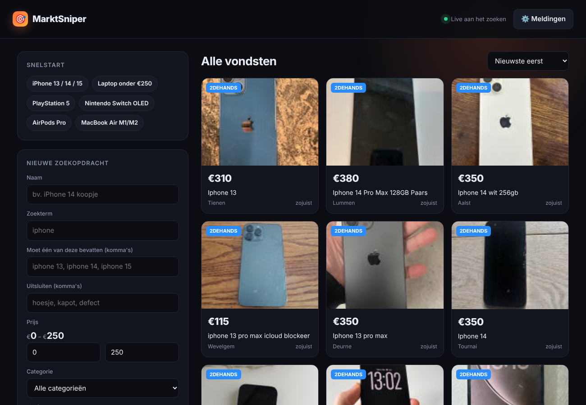

# 🎯 MarktSniper

Zoekt automatisch op **Marktplaats**, **2dehands** en **Vinted** en stuurt je een pushmelding zodra er een koopje opstaat.



## Starten

```bash
pip install -r requirements.txt
python app.py
```

Open daarna **http://localhost:8000**.

## Zo werkt het

- **Snelstart**: één klik voor iPhone 13/14/15, laptop onder €250, PS5, Switch OLED, AirPods Pro, MacBook Air M1/M2.
- **Zoekterm**: wat er op de site wordt gezocht (bv. `iphone`). Elk product op de sites kan dus.
- **Moet één van deze bevatten**: de titel moet één van deze termen hebben, bv. `iphone 13, iphone 14, iphone 15`
  (een iPhone 12 of 16 komt dan niet door).
- **Uitsluiten**: advertenties met deze woorden worden genegeerd (`hoesje, kapot, defect, icloud`).
- **Prijs**: stel per zoekopdracht je minimum- en maximumprijs in.
- **Categorie**: alle hoofdcategorieën van Marktplaats/2dehands.

Bij het aanmaken worden bestaande advertenties stil opgeslagen; je krijgt alleen meldingen van **nieuwe** advertenties.

## Meldingen op je telefoon

1. Installeer de gratis app **ntfy** (iOS / Android).
2. Abonneer je op een eigen, moeilijk te raden topicnaam.
3. Vul die naam in bij **⚙️ Meldingen** in de app en klik op *Testmelding*.

Telegram kan ook (bot token + chat ID), en browsermeldingen op je computer.

## Let op

- De app moet aan blijven staan om te zoeken (pc, Raspberry Pi of een kleine server).
- Vinted blokkeert soms verzoeken (vooral vanaf servers/VPN). Thuis werkt het meestal; zie je
  "⚠ geblokkeerd: vinted", dan werken Marktplaats en 2dehands gewoon door.
- Zoek niet vaker dan nodig (standaard elke 2 minuten) om geblokkeerd worden te voorkomen.
